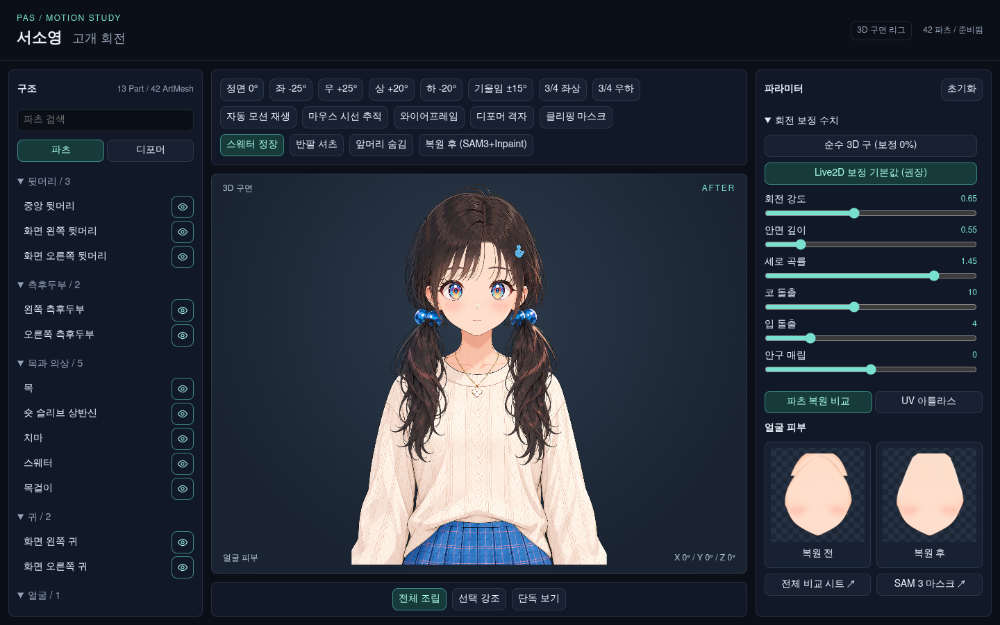

# Seosoyoung Motion Portrait

A static WebGL portrait viewer with a closed 3D head sphere, rigid child eyeballs, layered artwork and hanging hair physics.



## Run

Serve the repository with Python 3, then open `http://localhost:8000/bundle/`:

```sh
python3 -m http.server 8000
```

The viewer has no remote runtime dependencies. Use the pose buttons, sliders, automatic motion, part selection, before/after comparison and sphere grid controls.

## Geometry

The head is a complete sphere of radius 262, centered at `(502, 326, 0)` in the artwork coordinate system. Yaw, pitch and roll rotate XYZ vectors with orthogonal matrices before orthographic projection. Yaw and pitch preserve the sphere center. Roll pivots the complete head around the fixed neck joint `(502, 568, 0)`, so its center follows an arc while the radius and circular silhouette remain unchanged. Depth testing and face culling select the visible surface.

The yellow guide remains a closed sphere. Portrait artwork has an independently tunable ellipsoid depth surface. The recommended preset uses a shallow face, a vertical jaw ribbon starting before the south pole, local nose/mouth depth, far-eye aperture compression and an adjustable diagonal residual. The pure preset sets the ratios to 1 and all correction amounts to 0. Both presets preserve the original artwork XY coordinates in the neutral pose.

The upper backing uses a sampled hair strip from our own crown drawing, with an open face and jaw region. It does not write depth over the illustration layers. Artwork ribbons are two-sided; the closed diagnostic sphere uses face culling. This avoids hiding ears or cutting the lower face at a sphere pole. The reconstructed rear is inferred from front artwork, not a captured rear view.

The diagnostic child eyes are radius-54 spheres. The recommended portrait keeps measured yaw anchors, adds curved socket depth and pitch foreshortening, and rotates radius-42 corneal caps with the head. Independent gaze is applied before that rotation. The projected eyelid opening clips the iris, pupil and highlights during blinking.

The neck stays stationary during pure yaw. Pitch and roll blend the hidden upper attachment into the body. One moving neck owns the skin above the collar; the shirt's duplicate upper neck is removed. Hair ties and hanging tails follow head attachment points and damped gravity motion.

All six front hair layers share a rounded dome, protected in front of the forehead by a smooth depth maximum. The upper backing meets that dome without a depth inset. The rear cranium retains the complete elliptical shell, with a narrow upper seam blend and yaw-only visibility. Crown, bangs and hairpin retain their illustration order. The hair controls adjust volume and far-side occlusion.

The face uses a silhouette mesh. Its calibrated yaw projection stays unchanged; pitch uses a rounded jaw section, making the chin rise into a U-shaped low-angle outline or descend into a V-shaped high-angle outline. The neck attachment follows the chin. The old pitched bounding-box keyforms remain reference measurements and no longer drive these surfaces.

This is a custom WebGL renderer and JSON format. It does not load or produce Cubism binary models.

## Rebuild

Python 3.12+ and Node.js 20+ are used by the build and checks. Install the Python dependencies in a local environment:

```sh
python3 -m venv .venv
.venv/bin/python -m pip install -r requirements.txt
.venv/bin/python -m playwright install chromium
.venv/bin/python pipeline/stage2_inpaint_and_clean.py
.venv/bin/python pipeline/stage3_build_viewer.py
node pipeline/test_sphere_3d.mjs
node pipeline/test_corrections.mjs
node pipeline/test_attachment.mjs
node pipeline/test_hair_shell.mjs
node --test pipeline/test_outline.mjs
node --test tests/head-turn.test.mjs
.venv/bin/python pipeline/verify_viewer.py
.venv/bin/python pipeline/verify_outline.py
```

Stage 2 reconstructs the 40 cropped RGBA parts from `source/character/` and the cached masks in `sam3_masks/`. Restoration uses deterministic pixel interpolation and alpha geometry; it does not call an external generative inpainting service. Stage 3 adds two independently segmented 45° cranium parts, fits the dome and face outlines from cached masks, and produces the paired 2048-square atlases, front/back sphere textures, meshes and rig data under `bundle/assets/`.

The optional `stage1_sam3_segment.py` uses the existing cached masks without network calls. Generating a missing mask calls the paid fal.ai SAM 3 endpoint and requires `FAL_KEY` in the environment. No credentials are included. Keep all masks to reproduce the provided build offline.

## Validation

The browser check starts and stops its own local HTTP server. It writes screenshots and `viewer_metrics.json` under ignored `debug/`.

Checks cover the rendered sphere silhouette at yaw, pitch and combined extremes; radius preservation for the head and child eyes; stationary neck under pure yaw; composited ear, nose, mouth and hair-tie visibility; eye clipping; independent gaze; before/after portrait textures and live correction controls; image and console errors; image enlargement; and narrow layout overflow.

The checked-in [metrics](docs/viewer_metrics.json) and [capture index](docs/validation.md) describe the current implementation. Sphere-grid and normal renders are available for front, left, right, up and down poses.

## Files

- `bundle/`: standalone static viewer and generated runtime assets.
- `source/character/`: supplied Seosoyoung artwork and minimal placement metadata.
- `sam3_masks/`: cached segmentation masks and non-secret generation metadata.
- `parts/`: restored transparent artwork with canvas bounding boxes.
- `pipeline/`: segmentation, restoration, atlas generation and validation.
- `docs/`: visual evidence and measured results.

## Correction study

The generic [deformation module](src/head-turn.mjs), [model](docs/deformation-model.md), [measurements](docs/measurements.md) and [surface comparison](docs/surface-comparison.md) were integrated from analysis commit `230782b`. They contain aggregate measurements and generic code, without third-party model files or per-vertex data. Viewer defaults are authored for this portrait, not recovered coefficients from those models.

`source/viewer/index.html` and `source/viewer/corrections.json` are the HTML and correction-schema sources. The viewer builder generates `bundle/index.html`, `bundle/corrections.mjs`, copies the shared deformation module, and writes the matching rig metadata. Local geometry and residual corrections in `bundle/geometry.mjs` are specific to this portrait. The guide sphere and child eye spheres stay rigid when art-surface settings change.
