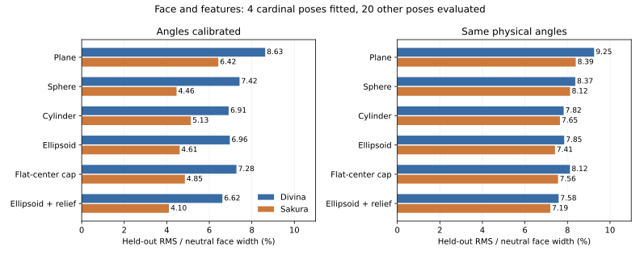

# 구면과 다른 3D 얼굴 형상의 오차 비교

**얼굴 전체의 기준면은 타원체와 부위별 깊이를 권한다.** 이번 두 모델에서 눈, 안구, 코, 입, 귀, 피부를 함께 평가했을 때 가장 낮은 미사용 포즈 오차를 냈다. 단, 표면만 바꿔 얻는 개선보다 남은 비강체 오차가 크므로, 이것을 최종 얼굴 변형으로 삼지 않고 2D 잔차 보정의 출발점으로 쓴다.

## 같은 비교 조건

삼각형의 연결은 그대로 두고 정면의 각 정점에 z 깊이를 부여하는 **표면 형상**을 비교했다. 구, 타원체, 원통 사이에 메쉬 연결을 다시 만드는 위상최적화는 하지 않았다. 결과는 원본 리거의 실제 3D 얼굴이나 유일한 해를 복원했다는 뜻이 아니다.

학습에는 상하좌우 네 끝 포즈 (-30,0),(30,0),(0,-30),(0,30)만 썼다. 정면은 각 형상에서 정확하게 보존한다. 평가에는 5×5 파라미터 격자에서 학습 네 포즈와 정면을 뺀 **20개 포즈**를 썼다. 대각선 네 코너도 학습에서 제외했다.

피부만 또는 피부, 코, 입, 눈L/R, 안구L/R, 귀의 8개 영역을 함께 맞췄다. 함께 맞출 때는 영역마다 같은 비중을 주고 영역 내 정점에는 같은 비중을 줬다. fitting에는 영역당 최대 180개 정점을 등간격으로 뽑고 평가에는 해당 영역의 모든 정점을 썼다. RMS는 모델 정면 피부 폭 W의 백분율이다. 두 모델의 표본은 독립적인 두 캐릭터이며 전체 Live2D 모델의 통계표본은 아니다.

각 후보는 동일한 직교 카메라와 yaw→pitch 순서를 사용한다. 회전 중심의 x/y를 얼굴 폭 기준 제한 범위에서 맞췄다. 경계가 있는 coordinate search를 서로 다른 세 시작점에서 실행하고 **학습 오차**로 최종 파라미터를 선택했다. 평가 오차로 파라미터를 다시 맞추지 않았다. 수치 탐색의 전역 최솟값 증명은 아니다. 후보 간 최종 순위를 이 평가 세트에서 고른 것이므로, 새 캐릭터에 대한 일반화 성능은 별도로 확인해야 한다.

## 후보 형상

| 후보 | 깊이 함수 | 기본 자유도 |
| :--- | :--- | ---: |
| 평면 | z=h | 5 |
| 구면 | z=√max(0,r²-x²-y²) | 5 |
| 세로 타원 원통 | z=rz √max(0,1-(x/rx)²) | 6 |
| 타원체 | z=rz √max(0,1-(x/rx)²-(y/ry)²) | 7 |
| 평평한 중앙의 곡면 | 위 타원체 식의 x,y 제곱을 4제곱으로 변경 | 7 |
| 타원체 + 부위 깊이 | 타원체 + 코/입/양쪽 안구의 상수 깊이 오프셋 | 10 |

기본 자유도에는 회전 중심 2개와 파라미터→실제 각도 배율 2개가 포함된다. 고정 각도 비교에서는 배율 2개를 1로 고정한다. 부위 깊이는 눈꺼풀, 귀에는 적용하지 않았고 안구 L/R은 하나의 깊이 오프셋을 공유한다. 이는 자식 안구 구를 완전히 추정한 모델은 아니다. 안구 구의 구조는 프로토타입의 별도 `eyePoint` 경로로 제공한다. 평면 밖으로 넘어간 점은 깊이 0의 띠로 처리한다.

## 회전량까지 맞춘 경우

| 형상 | Divina 피부 %W | Sakura 피부 %W | Divina 얼굴 전체 %W | Sakura 얼굴 전체 %W |
| :--- | ---: | ---: | ---: | ---: |
| 평면 | 6.58 | 6.56 | 8.63 | 6.42 |
| 구면 | 6.14 | 5.84 | 7.42 | 4.46 |
| 세로 타원 원통 | 6.44 | 6.56 | 6.91 | 5.13 |
| 타원체 | 6.53 | 6.05 | 6.96 | 4.61 |
| 중앙이 평평한 곡면 | 6.52 | 6.09 | 7.28 | 4.85 |
| 타원체 + 부위 깊이 | 해당 없음 | 해당 없음 | 6.62 | 4.10 |

피부만 보면 구면이 가장 낮다. 그러나 Divina의 이 fit은 구 반지름을 얼굴 폭의 약 1.16배로 키우고 yaw/pitch 배율을 약 0.267/0.214로 줄였다. 파라미터 30에서 물리적 yaw는 약 8°다. **작게 돌리는 큰 구가 2D 피부 이동을 근사한 결과**로 해석해야 한다. 이 수치만으로 머리를 실제 공처럼 만들라고 결론내릴 수 없다.

얼굴 전체에서는 타원체+부위 깊이가 두 모델 모두 가장 낮다. Divina에서는 타원체의 세로 반지름이 탐색 상한에 닿아 세로 원통에 가까워졌다. 따라서 유일한 타원체 치수를 확정하지 않고, 세로 곡률이 약한 안면과 부위별 깊이가 유용하다는 근거로 삼는다. 단순 구면 대비 개선은 각각 0.81%p, 0.36%p다.

## 같은 실제 각도에 고정한 경우

파라미터 30을 실제 30°로 고정하고 형상과 회전 중심만 맞춘 결과다.

| 형상 | Divina 피부 %W | Sakura 피부 %W | Divina 얼굴 전체 %W | Sakura 얼굴 전체 %W |
| :--- | ---: | ---: | ---: | ---: |
| 평면 | 8.91 | 8.41 | 9.25 | 8.39 |
| 구면 | 11.26 | 8.74 | 8.37 | 8.12 |
| 세로 타원 원통 | 8.81 | 8.41 | 7.82 | 7.65 |
| 타원체 | 8.88 | 8.12 | 7.85 | 7.41 |
| 중앙이 평평한 곡면 | 8.87 | 8.17 | 8.12 | 7.56 |
| 타원체 + 부위 깊이 | 해당 없음 | 해당 없음 | 7.58 | 7.19 |

같은 각도에서도 타원체+부위 깊이가 얼굴 전체에서 가장 낮다. 구면 대비 Divina 8.37→7.58%W, Sakura 8.12→7.19%W다. 피부만의 최저 후보는 Divina에서 원통, Sakura에서 타원체다. 즉 **피부 윤곽과 이목구비를 같은 강체 표면 하나로 모두 설명하기 어렵다**는 것이 일관된 결과다.

## 서소영에 적용할 판단

1. 두상, 머리카락 외피는 구 또는 타원체로 시작한다. 안면의 앞뒤 깊이를 독립적으로 조절할 수 있어야 한다.
2. 눈은 자식 구에 붙이고, 코, 입은 안면보다 다른 깊이를 줄 수 있게 한다. 각 부위 깊이값은 서소영 원화와 목표 포즈에서 정한다.
3. 피부 윤곽, 반대편 눈의 압축, 턱, 목 연결과 대각선은 2D 잔차로 교정한다. 외부 모델의 깊이/잔차 수치를 서소영에 복사하지 않는다.
4. 모델별 숫자를 최적 3D 정답으로 쓰지 않는다. 회전각, 깊이, 회전 중심 사이의 모호함과 학습 경계에 닿은 파라미터가 있다. 실제 원화의 시각적 판단은 별도다.

`liftEllipsoid`는 독립 반지름 rx/ry/rz와 부위 relief를 받는다. `bakeResidual`과 `deform`의 마지막 인자로 `liftEllipsoid`를 넘겨 같은 표면을 기준으로 잔차를 만들고 적용할 수 있다. 도메인과 실제 각도 매핑은 작성자가 일치시켜야 한다.

## 재현과 한계

[fit_surfaces.py](../tools/fit_surfaces.py)에 후보, 경계, 시작점, train/test 분할과 가중치를 공개했다. 자체 생성한 평면의 정답 회전으로 예측과 fitting을 검사했고, 학습/평가 포즈가 겹치지 않는지도 검사했다. 정점별 임의 깊이를 두어 표본에 과적합하는 후보와 텍스처 재구성은 사용하지 않았다. 외부 모델 파일과 결과 좌표는 포함하지 않는다.

이 문서의 fitting 비교는 20개 포즈다. [9키 잔차 비교](measurements.md)의 평가 16개 중간 포즈와 표본이 다르므로 두 표의 숫자를 같은 성능 순위로 섞지 않는다.
