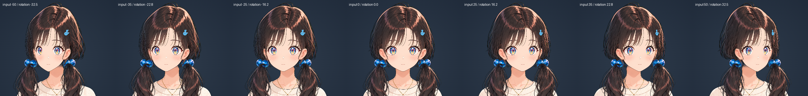

# r14 depth-fitted face mask and body-linked motion

The lower face now uses a symmetric 3D depth surface fitted from Depth Anything V2 and constrained to the depths reconstructed from the approved ±45° outline. Pitch rotates that surface first; the 2D outline residual then samples reference widths by the rotated height `s_rot`. The cheek-width residual is limited to prevent the earlier puffed-up cheeks and over-pinched down pose. The new surface joins the existing face above y465, keeps its measured edge depths, and reaches the measured chin depth.

`ParamBreath` and `ParamBodyAngleX` now move the neck’s upper section and every non-body upper mesh together. The lower neck fades into the torso. Auto motion drives both breathing and a small left-right body sway. The `CorrOutline < 1` feature fallback uses the local deformation path to avoid adding the shared body offset twice.

| Gate | Result |
|:--|:--|
| Node tests | `test_outline`, `test_pitch_3d`, and `test_9dir`: 47 passed, 0 failed |
| Attachments | 200 pose/mesh cases passed; no collapsed 3D triangles or inverted flat-artwork ribbons |
| Outline raster | One PASS on the fitted face; no interior holes, cheek-ear gaps, forehead intrusion, or far-back exposure |
| Viewer | One final PASS: 972 canopy samples with zero error; 72 attachment poses with zero flat-mesh folds; face-mask 3D area ratio 0.556 minimum; WebGL, console, request, neck clipping, feature clipping, and narrow-layout checks pass |

The face mask has 40 screen-projected back-facing triangles across the viewer’s tested poses. Their 3D area remains intact; the validator records them separately from flat-mesh folds, and WebGL culls their backs in the face, neck-mask, and silhouette passes. All 1,176 source face triangles use the configured CW front winding. The final post-culling 9-direction sheet was opened and inspected. `up` retains a rounded U-shaped jaw without a lateral cheek bulge, and `down` keeps the mouth-side jaw width while shortening the lower face. The `left`, `front`, and `right` pitch-zero tiles are pixel-identical to the prior PR capture.

Evidence: [viewer metrics](viewer_metrics.json), [outline metrics](outline_metrics.json), [nine directions](captures/viewer_9dir_grid.png), [bundle SHA256](bundle-sha256.txt). Outline raster evidence was produced before the body-motion wrapper was added; at its zero body-motion defaults, the wrapper returns the original local deformation unchanged. Merge, deployment, and specialist UI/UX review remain with the coordinator.

## Earlier r11 baseline: measured attachments and a continuous hair surface

This revision preserves the approved face silhouette fit and corrects the ears, twin-tail roots, eyes, nose, mouth and hair surface. It uses the independently generated left/right references, not mirrored lighting. The viewer remains a custom WebGL rig, not a native Cubism model.

## Reference data


SAM 3 provenance is recorded in [the segmentation manifest](../sam3_masks/references/manifest.json). The right full-crown segmentation was rerun successfully; the earlier 32-pixel result is not used. All three crown masks now contribute 168 upper-contour samples. The least-squares ellipse has `cx=502`, `cy=385.773687`, `rx=277.847816`, `ry=351.513220`; contour RMS is 10.9345 canvas pixels, maximum 21.2846 pixels. This is a smooth volume estimate, not an exact reconstruction of every drawn strand.

The front cap's joining boundary comes from the solid runs of the existing crown and side-hair alpha, sampled every two pixels from y=60 to 350. Detached wisps are retained as overhangs, not used to inflate the skull. The boundary is smoothed over eight canvas pixels and inset two pixels into opaque artwork. [Dome fit data](../source/viewer/dome-fit.json) includes the resulting rows.

## Measured attachment transforms

Ears use `z0 = (xRef - 502 - (x0 - 502) cos(thetaRef)) / sin(thetaRef)`. Each side has its own measured front/reference box and vertical displacement. Inner attachment depth is positive and the outer ear is posterior; a single arbitrary positive spherical relief is no longer applied. The inverse ear mask has been removed. Front hair/cheek depth and ordinary draw order hide the attachment; the far ear fades to zero by effective 25°.

Twin-tail hair and beads share their measured bead anchor, rather than a point on the front hair sphere. Near-side triangulation gives approximately −75 px and −72 px rest depth. Odd `sin(theta)` and even `1-cos(theta)` residuals fit the independently observed opposite endpoints.

| Landmark | Front | Left −45° | Right +45° |
|:--|:--|:--|:--|
| Left iris center | 415.7, 432.2 | 362.4, 429.3 | 514.2, 430.7 |
| Right iris center | 588.1, 430.8 | 525.1, 429.2 | 670.1, 428.9 |
| Nose | 508, 497 | 406.9, 497.1 | 629.9, 490.5 |
| Mouth | 504.5, 554.5 | 434.1, 556.2 | 598.7, 553.3 |
| Left bead | 306.5, 544.2 | 304, 542.2 | 310.5, 544.2 |
| Right bead | 691.5, 542.6 | 686.8, 542.3 | 709.3, 544 |

Every eye component uses the same measured pivot and horizontal scale, including sclera, lashes, lower line, brow, iris, pupil, highlight and closed-eye artwork. Outline expansion is not applied independently to iris vertices. Left-far scale is 36/44; right-far scale is 0.72, respecting the final requested lower limit rather than the raw 31/43.9=0.706 measurement. Near scales are 45/44 and 47/43.9. Nose and all three mouth variants use their own fitted pivots. Eye gaze, blinking and mouth expression remain separate local deformations. Eye, eyebrow, closed-eye, nose and mouth artwork is rendered as a face decal after skin and before hair: the measured mouth anchor has z=119.39 at rest while the preserved skin is z=129.97, so ordinary depth testing would incorrectly erase the mouth. Its measured motion coordinates are unchanged.

The near front lock has a measured endpoint shape and an intermediate `12° sin²(4 theta)` angular advance. It preserves 0°/45° positions and endpoint velocities; its angular derivative remains positive. This is an artistic intermediate keyform for ear exposure, not a uniquely triangulated third view.

## Hair surface and texture

Each horizontal section is `(cx(y) + rx(y) sin(lambda), y, cz(y) + rz(y) cos(lambda))`. Front artwork is lifted by inverse longitude; the auxiliary side texture is projected at its own ±45° reference. Pitch and roll operate on the resulting 3D coordinates. There is no old outer-coordinate pin and no whole-part cranium opacity ramp.

At ear height the skull narrows to `rx=175`. Its posterior center and depth radius solve both the ear attachment and the measured 45° support:

```text
cz + rz sqrt(1 - (123.5 / 175)^2) = 28.7
(sqrt(175^2 + rz^2) - cz) / sqrt(2) = 276.5
rz = 208.3646326524; cz = -118.9256212554
```

The side surface starts at 88° intrinsic longitude, with a two-degree geometric overlap at the front horizon to prevent raster cracks. The two-degree collar folds onto 90° at rest and unfolds geometrically over the first ten degrees. It is opaque; normals reject rear-facing fragments. Actual front occlusion is checked in the renderer rather than inferred from a vertex count. Lower hanging locks follow their stereo targets; the face-following displacement is confined to the inner 30 pixels. Upper locks share the skull transform through y=350.

Full-height SAM crown regions supply the side textures. Local OpenCV inpainting fills ear notches and invalid white/skin fringes using hair texels; no new generative inpainting request is made. Hidden inter-part gaps in the front crown are also filled. The immutable restoration inputs are in `source/front-hair-inputs/`. The added crown fill returns to the original alpha over the last 24 crop pixels, avoiding a rectangular color shelf; the original opaque artwork and the upper joining seam stay intact.

A front photograph has vanishing texture resolution at its silhouette (`dx/dlambda = rx cos(lambda)`). Merely adding mesh vertices cannot recover missing side hair detail. Near the horizon, the renderer therefore samples RGB from the independent 45° texture on the **same geometric surface**. It blends only RGB, never alpha, coverage or depth. Front RGB is unchanged at zero yaw. Reference UVs remain continuous across triangles and the fragment shader checks the valid atlas rectangle before mixing, preventing atlas-border contamination. This removes the stretched zigzag highlights without a translucent floating patch.

The upper center-back part is the continuous crown backing. Its lower dangling region is clipped with the far hair from y=407; clipping this backing at y=310 had cut a large hole in the crown. Separate far side/back ribbons retain their occlusion from y=310. Validation checks the upper skull's coverage/curvature separately from lower rear-strand exposure.

## Mesh scope

Ear, hair, hairpin and twin-tail meshes use constrained alpha-silhouette triangulation. Concavities, holes and thin strands are retained; attachment points are explicit vertices. The common horizon is also a constrained polyline: a triangle must not bridge an opaque inner surface and a transparent outer wisp across the inverse-projection limb. The side cranium uses a longitude/height grid for a curved surface. The approved face-skin mesh and `face-outline.mjs` / `outline-data.mjs` remain unchanged. Eyes, mouth, body and clothing retain their existing topology because their local expression deformation has not changed.

Real spherical backfaces are culled. Tests distinguish them from collapsed 3D triangles and from reversed front-facing illustration ribbons; this revision does not claim that every projected spherical triangle has positive signed area at every yaw.

## Preserved face fit

The existing cheek/jaw quartic fit has RMS 1.953 px and maximum 5.930 px against sampled SAM edges. Runtime left/right boundary residuals use `sin(theta)` and `1-cos(theta)` and agree with the fitted targets within 0.001 px at ±45°. Front chin (502.5,616) moves to (441.5,615) / (586,615). The measured image and the fitted target remain distinct in [outline traces](../source/viewer/outline-traces.json).

Recommended gain remains 0.65: input ±50 means actual ±32.5°. Dedicated reference captures use gain 1 and input ±45. Face fitting clamps beyond ±45° while the hair surface continues rotating.

## Captures



| Pose | Capture |
|:--|:--|
| Front | [Front](captures/viewer_1440_front.png) |
| Input −50 / +50 | [Left](captures/viewer_1440_turn_left_50.png), [right](captures/viewer_1440_turn_right_50.png) |
| Actual −45° / +45° | [Left](captures/viewer_actual_45_left.png), [right](captures/viewer_actual_45_right.png) |
| Pitch −20 / +20 | [Down](captures/viewer_1440_pitch_down_20.png), [up](captures/viewer_1440_pitch_up_20.png) |
| Narrow layout | [1024×768](captures/viewer_1024_narrow.png) |

The specialist visual review and merge/publication belong to the coordinating session.

## Quantitative verification

Four required near-ear measurements, at 1440×900 CSS pixels and DPR 2:

| Input / gain | Effective yaw | Visible near-ear pixels |
|:--|--:|--:|
| −50 / 0.65 | −32.5° | 1950 |
| +50 / 0.65 | +32.5° | 2224 |
| −45 / 1 | −45° | 2017 |
| +45 / 1 | +45° | 2274 |

All 14 pose/gain cases have zero front ear intrusion, zero exposed far lower-back pixels, zero head-interior holes and zero cheek–ear gap pixels. Front and far cranium contribution is zero; the near surface is visible when turned. Head-interior sampling follows the fitted section from y=80 to 420, inset 15 canvas pixels from loose strands/antialias edges. It catches both enclosed holes and the formerly open upper seam. Ear-gap sampling separately checks the face–ear attachment from y=440 to 490.

The upper outline is sampled every ten canvas pixels from y=60 to 420. Maximum inward midpoint deviation is 16.0279 px, below the 20 px tolerance for the original drawing's loose strands (previous front-art baseline approximately 17.5 px). This is a step/notch detector, not a claim that every individual strand forms a mathematically convex silhouette. The fitted upper dome itself has continuous ellipsoidal curvature.

| Executed check | Result |
|:--|:--|
| Outline/stereo tests | 14 passed; measured eye, nose, mouth, ear, bead and face endpoints |
| Attachment sweep | 200 cases; no collapsed 3D original-part triangles or reversed facial ribbons; spherical backfaces culled |
| Hair/face preservation | 118 checks passed |
| Correction controls | 402 checks passed |
| Sphere and head-turn baseline | Sphere/eye rigidity and fixed neck passed; 12 head-turn tests passed |
| Alpha silhouette topology | 2 tests passed: concavity/thin-strand coverage and constrained horizon |
| WebGL outline raster | 14 poses passed; required ears ≥1800 px and all hole/occlusion checks zero |
| Raster checker mutation tests | 9 injected violations rejected |
| Full viewer/browser | Passed: feature visibility, iris clipping, neck coverage, controls, narrow layout and zero WebGL/console/request errors |

[Raster evidence](outline_metrics.json) preserves all values and contour rows. Shader/geometry/mesh changes received independent code review; the UV-boundary finding was corrected and rechecked.

## Direct visual inspection

The eight requested final captures were opened directly: front, input ±50, actual ±45°, pitch ±20 and the yaw sweep. Near ears remain visible with the beads beneath them; the side skull has opaque coverage and a rounded upper outline. The crop-edge shelf and missing mouth found during inspection were corrected. The sweep shows the far locks folding inward without a detached translucent side patch. This is the implementation inspection; specialist aesthetic review remains with the coordinator.

The existing viewer layout, controls and typography were reused without UI dimension changes. [Browser evidence](viewer_metrics.json) and [bundle SHA256 manifest](bundle-sha256.txt) accompany these captures.

## Reproduction

Run `pipeline/stage3_build_atlas_and_rig.py` with the repository virtual environment. It rebuilds the front gap fill, fitted sections, side textures and 2048 atlas deterministically from checked-in inputs. Python dependencies are in `requirements.txt`; use the shared heavy-work runner for atlas builds and Playwright on eiaserinnys.

Focused checks are `pipeline/test_outline.mjs`, `test_hair_shell.mjs`, `test_attachment.mjs`, `test_corrections.mjs`, `test_silhouette.py`, `verify_outline.py`, `check_outline_metrics.py` and `verify_viewer.py`. Node tests use a 60-second test timeout. The silhouette fixture covers a concave notch and a narrow disconnected strand.

## Eye decal correction

The first revision omitted unmasked eye layers from the face-decal branch. Their measured anchor depth was behind the preserved skin: the front lower lines, brows and sclera contributed zero pixels, while the masked iris remained visible. All `eye-*` layers and `closed-eyes-v1` now use the same decal depth policy as nose/mouth. Masked iris clipping and the later side/front hair rendering remain intact.

The assembled-view visibility test now includes both upper lashes, lower lines, brows and sclera, across the original seven poses plus input ±50°. These nine poses require every tested eye layer to contribute visible pixels. Actual ±45° additionally checks side-hair occlusion. At those endpoints a separate all-parts render with hair hidden verifies that the near eyebrow is visible over skin, independently of the hairstyle’s occlusion. This distinguishes intended hair occlusion from the rejected skin-depth failure without changing the approved hairstyle or feature coordinates.

Final browser verification passed: 72 assembled eye-layer observations are nonzero (minimum 27 pixels at DPR 1). Side-hair occlusion at actual −45°/+45° covers 16/14 eye pixels. With hair hidden, the near brows contribute 68/76 pixels. Updated captures include front, input ±50°, actual ±45°, pitch ±20°, yaw sweep and the narrow layout.

## Temple depth continuity

The upper inner side-hair used the broad skull depth (about +215 px) while its covering fringe used about +121 px. At actual −45° the right temple sample (674,330) projected to x=476.05 and crossed the forehead arch. The inner temple now blends from fringe depth into the measured hanging lock between y260 and407. The influence rises inward over 60 pixels from the common horizon and over y200..260; at the outer seam it is exactly zero. At y407 the established lower-lock transform is unchanged.

Moving that lock exposed seven background pixels at +32.5°: a reverse projection found the central backing's transparent 1–2 texel edge at source x310..312, y374. The backing's existing filled region now overlaps by two texels over y200..400, inpainted from neighboring hair. This keeps the joint covered without changing the foreground silhouette or face fit.

The raster contract identifies the near side-hair in the assembled image and requires zero pixels in y280..365 with x<535 for left turns and x>469 for right turns, at effective ±32.5° and ±45°. Geometry checks also preserve both outer seams at y200,260,330,350 across three yaw values.

Final temple verification: all four forehead intrusion counts are 0; all 14 pose/gain cases retain 0 interior-hole, cheek–ear-gap and far-back-exposure pixels. Required near-ear counts remain 1950/2224/2017/2274. The full browser suite passes with all 72 eye-layer visibility observations nonzero. All nine requested captures were regenerated and opened; the left-turn forehead arch shows skin rather than the former diagonal side-hair patch.
